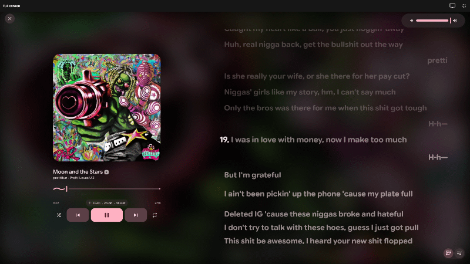
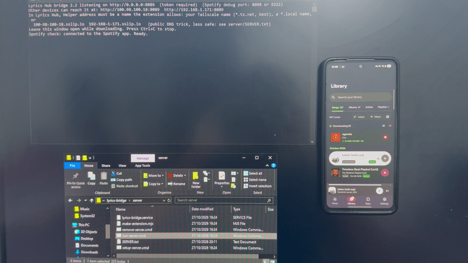

# Mornye lyrics extensions

One lyrics extension for [Mornye](https://github.com/mornyeapp/Mornye) (mobile) and
[Mornye Desktop](https://github.com/mornyeapp/Mornye-Desktop): **Lyrics Hub**, with word-by-word sync, background vocals, duets,
translation and 15 lyric sources. A small optional **helper** (`lyrics-bridge`) adds Genius, YouTube Music and the Spotify song lookup.

## What's in this repo

| File or folder | What it is |
|---|---|
| [`registry.json`](registry.json) | The list Mornye's **Repo** tab reads, so Lyrics Hub installs and updates from this repo (see [Install](#install)) |
| [`dist/lyrics-hub_1.3.1.mornye-ext`](dist/) | **The extension itself.** You can also install this file by hand |
| [`dist/lyrics-bridge.zip`](dist/) | The helper, ready to unzip and run (the same files as `bridge/`). Optional. |
| `extensions/lyrics-hub/` | Source of the extension (`src/*.js`, `manifest.json`, the built `index.js`, `tests/`) |
| `bridge/` | Source of the helper. Every file in it is explained in [`bridge/README.txt`](bridge/README.txt) |
| `make-registry.js` | Rewrites `registry.json` after each release (see [Releasing](#releasing)) |
| `CHANGELOG.md`, `LICENSE` | What changed in each version, and the licence |

## Which setup do I need?

| I want | Install | Helper |
|---|---|---|
| The 13 normal lyric sources (Spicy Lyrics, lrc.red, AMLL TTML DB, BiniLyrics, Musixmatch, Unison, LRCLIB, LRCMux, NetEase, QQ Music, KuGou, Kuwo, Deezer) | The extension | **None.** Skip to [Install](#install) |
| Also **Genius**, **YouTube Music** and the **Spicy Lyrics Spotify lookup**, on one PC | The extension | [Helper on this PC](#helper-on-this-pc) |
| The same on **phones, tablets or other computers** | The extension on each device | [Helper on a second computer](#helper-on-a-second-computer-phones-and-other-devices) |

## Install

**From Mornye's Repo tab (recommended, it also shows updates):**

1. In Mornye, open the **Repo** tab and tap **Add Repository**.
2. Enter `https://github.com/yendumont/lyric-extension` and confirm. (Mornye reads `registry.json` from the repo. The direct link works too: `https://raw.githubusercontent.com/yendumont/lyric-extension/main/registry.json`.)
3. Install **Lyrics Hub**.

**Or by hand:** download `lyrics-hub_1.3.1.mornye-ext` from `dist/` and install it from the Extensions page.

Then:

1. For Spicy Lyrics, paste your free key from <https://developers.spicylyrics.org> into the extension's settings.
2. In **Settings > Lyrics > Lyrics providers**, switch **Lyrics Hub** on, move it to the top and switch the other providers off.
3. Optional: **[Tools] Test connection** in the extension's settings checks your keys and helper.

## Lyrics Hub

It asks the lyric sources the [Lyric Viewer](https://github.com/yendumont/lyric-viewer) uses, from one extension, and keeps the best-synced result.

- **Word-by-word sync.** Word timing is written as `<mm:ss.xxx>` tags inside each line, which is what Mornye reads.
- **Background vocals** as a small line under the main lyric, and **duets** (the second singer's lines are tagged `v2:` so Mornye shows them on the right). Both can be turned off.
- **Timing offset** (in ms, negative = earlier) and a **Word-by-word timing** switch for comparing.
- **Source order and switches.** Type your own order (names or ids, separated by commas or `>`); sources you leave out follow in the default order. With **prefer best sync** on it keeps looking until word timing turns up, off it uses the first source in your order that has synced lyrics.
- **Translation.** With your own Gemini key, *line* adds a translation line under each lyric (`[x-translation]`, shown by Mornye as the translation). *word* splits the translation into chunks tied to the sung words and sends them as `[x-romaji]` + `[x-romaji-words]`, so Mornye shows them in its word-by-word "pronunciation" slot (use the lyrics language button). Mornye has no separate word-synced translation slot.
- **Diagnostics.** **[Tools] Last lookup** shows which sources were asked, in what order, and which one answered.

<p align="center"></p>
<p align="center"><sub>Word-by-word sync in Mornye.</sub></p>

Settings are grouped by the label prefix: **[General]** prefer best sync, source order, accept unsynced, word timing, background vocals, duet sides, timing offset, search time limit; **[Sources]** an on/off switch per source and the lrc.red / BiniLyrics word-sync mode (`hand`, `all`, `off`); **[Keys]** Spicy Lyrics, Musixmatch, optional Spotify; **[Translation]** off / line / word, language, Gemini key and model; **[Helper]** YouTube Music, Genius (favourite artists, loose search, best-guess match), the Spotify-app lookup, and where the helper runs (address and token); **[Tools]** test connection and last lookup.

Not included: Genius' cover-based matching and alias learning, Genius line meanings, and animated album covers (an extension can only return lyrics, not artwork).

## The helper (`lyrics-bridge`)

Genius and YouTube Music only answer a normal program, not an extension's sandbox, and the Spotify song lookup needs Spotify's debug port, which needs a WebSocket.
Extensions can't do either, so this small program does it for them and Lyrics Hub asks it. It needs **Node.js 22 or newer** (the LTS from <https://nodejs.org>; don't tick the "native modules" box) and nothing else.

| Lyrics Hub setting | Helper | What the helper gives |
|---|---|---|
| none of the below | not needed | the 13 normal sources |
| Genius, YouTube Music | running | those two (plain text, tried last) |
| Spicy Lyrics, Musixmatch, AMLL | running, **and** Spotify open there with its debug port on | the exact Spotify song ID. Without it the extension uses a ListenBrainz / iTunes / Deezer lookup instead |

If the helper isn't running, Lyrics Hub skips those sources and carries on with the rest.

### Helper on this PC

Setup, once:

1. Install **Node.js 22 or newer**.
2. Only for the Spotify lookup: start Spotify with the debug port open. With Spicetify, put this in `%APPDATA%\spicetify\config-xpui.ini` under `[Setting]`, then run `spicetify apply` and restart Spotify:
   `spotify_launch_flags = --remote-debugging-port=8088`
3. In Mornye Desktop: **Settings > Download > Allow Local Network Access**.
4. Leave **[Helper] Helper address** empty in Lyrics Hub.

Every time: double-click `bridge/start-lyrics-bridge.cmd` and leave its window open while downloading. This mode only answers programs on the same PC and needs no token.

### Helper on a second computer (phones and other devices)

Android and iPhone can't run the helper, so run it on another laptop that stays on, in **server mode**. Every request needs your secret token (`X-Bridge-Token`); without it the helper answers 401.

<p align="center"></p>
<p align="center"><sub>A phone using the helper on a second computer.</sub></p>

1. On that computer install **Node.js 22 or newer**, and for the Spotify lookup do step 2 above there.
2. On Windows, double-click `bridge/server/setup-server.cmd`: it makes the token, starts the helper at every logon, opens the firewall and prints what to enter. (Linux: `bridge/server/lyrics-bridge.service`.)
3. On each device, in Lyrics Hub enter **[Helper] Helper address** and **Helper token**, then **[Tools] Test connection**.

The address has to be a name the extension allows: your [Tailscale](https://tailscale.com) name (`yourlaptop.tailxxxx.ts.net`, works at home and away, the best choice), a `.local` name on the same Wi-Fi, or `192-168-1-50.sslip.io` for an IP (a free public DNS service that turns it back into 192.168.1.50). **Warning:** sslip.io means trusting that service not to point the name elsewhere, and the token travels unencrypted, so Tailscale is safer. A bare IP address or your own domain needs `node bridge/server/make-extension.mjs <address>`, which writes a Lyrics Hub build that allows it. Never port-forward the helper to the internet.

Full steps (sleep settings, firewall, Linux, Cloudflare Tunnel, updating) are in [`bridge/server/SERVER.txt`](bridge/server/SERVER.txt).

**Safety.** The helper answers only `GET` requests to `/health`, `/search`, `/genius/*` and `/ytm/*`, and refuses any request with an `Origin` header, so websites can't use it. On this PC it listens only on `127.0.0.1`. Server mode requires the token on every request and blocks an address after ten wrong ones. The token lives in `bridge/.env`, which `.gitignore` keeps out of the repo. While Spotify's debug port is on, any program on that computer can use that port.

## Building

- **Extension:** `cd extensions/lyrics-hub && sh build.sh` joins `src/*.js` into `index.js`. Tests: `cd tests && node run.mjs formats.test.mjs providers.test.mjs engine.test.mjs bridge_sources.test.mjs`.
- **Package:** a package is a zip with `manifest.json` and `index.js` at its root, renamed to `.mornye-ext`:

  ```sh
  cd extensions/lyrics-hub
  zip -X ../../dist/lyrics-hub_1.3.1.mornye-ext manifest.json index.js
  ```
- **Helper:** `cd bridge/tests && node --test bridge.test.mjs`. `dist/lyrics-bridge.zip` holds `lyrics-bridge.mjs`, `start-lyrics-bridge.cmd`, `README.txt` and `server/`.

### Releasing

After changing the extension: raise `version` in `extensions/lyrics-hub/manifest.json`, run `sh build.sh`, zip the new `dist/lyrics-hub_<version>.mornye-ext` (above), then run `node make-registry.js` from the repo root. It rewrites `registry.json` with the new version, the download link and the file's sha256 (Mornye refuses a download that doesn't match it), so commit `registry.json` together with the new package. Delete the old package from `dist/`.

## Credits and terms

- Based on my prior **Spicy Lyrics** and **Unison** extensions for SpotiFLAC Mobile.
- **Spicy Lyrics** lyrics come from [developers.spicylyrics.org](https://developers.spicylyrics.org) with your own key, and its
  [attribution rules](https://developers.spicylyrics.org/docs/attribution) apply. The provider name shown in Mornye carries the credit.
- **Unison** lyrics come from <https://unison.boidu.dev> ([Better Lyrics](https://github.com/better-lyrics/unison), ODbL, attribution required).
- The idea of reading Spotify through its debug port, and the search call used, come from
  [yendumont/lyric-viewer](https://github.com/yendumont/lyric-viewer) (AGPL-3.0).
- Not affiliated with Mornye, Spotify, Spicy Lyrics or Unison etc.
